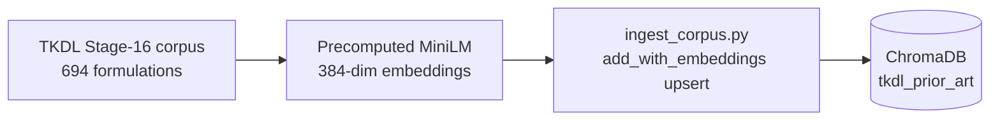
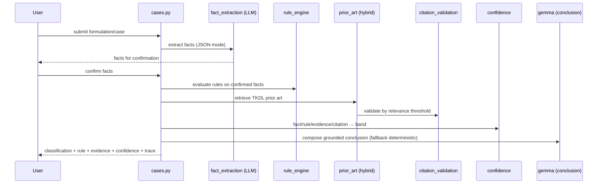

# IP-SAKTI Sahayak — Final System Architecture & Dataflow (SIH 2026)

**Document type:** Engineering design & dataflow specification for the *production* build.
**Audience:** Backend, ML, and platform engineers building the fully-fledged system.
**Status:** Living document. Sections tagged **[CURRENT]** describe what the working
prototype already does; **[FINAL]** describes the target production design; **[NEW]**
marks the custom ML agentic layer that replaces the prototype's deterministic controller.

> One-line mission: *A source-grounded, multilingual assistant that answers Ayurvedic
> IP / ABS / drug-regulatory questions with citations and jurisdictional clarity —
> and safely abstains when it lacks authority.*

---

## 1. Design principles (non-negotiable)

These hold across every layer, prototype and final alike:

1. **Evidence-grounded, cite-or-abstain.** Every legal/regulatory statement is backed
   by a retrieved source or a curated rule with a citation. If authority is missing:
   *"Insufficient authoritative evidence."* The system never fabricates statutes,
   sections, treaties, cases, URLs, or citations.
2. **Deterministic authority, generative phrasing.** The *facts and citations* are
   produced by deterministic code and curated data; the LLM only *phrases* them.
   No legal rule is ever invented by a model.
3. **Jurisdiction separation.** India and International answer-sets are computed and
   presented separately and never conflated.
4. **Information, not legal advice.** A standing disclaimer + a human-facilitator
   escalation path accompany every answer.
5. **Graceful degradation.** If the LLM (or any optional component) is unavailable,
   the system still returns deterministic, evidence-based results.
6. **Privacy & auditability by default.** Consent-gated access to paid sources, audit
   logs, masked secrets, DPDP-aligned handling.

---

## 2. High-level architecture

```mermaid
flowchart TB
  subgraph Client["Frontend — Next.js 15 / React 19"]
    UI[Tool UIs: Ask, Classifier, ABS, TKDL,\nRegulatory, Jurisdiction Diff, Deep Research]
    I18N[Multilingual + Voice layer]
  end

  subgraph API["Backend — FastAPI"]
    ROUTES[API routers]
    ORCH[Orchestration:\nagentic + pipeline]
    RAG[Retrieval layer]
    RULES[Deterministic rules + jurisdiction configs]
    GRAPH[Knowledge graph]
    MLL[ML layer]
    GUARD[Guardrails / validators]
  end

  subgraph Data["Data & Knowledge stores"]
    VDB[(ChromaDB\nTKDL vectors)]
    SQL[(SQLite / Postgres\nusers, cases, facts, audit)]
    KG[[knowledge_graph.json]]
    JUR[[india.json / international.json]]
    MLREG[(Model registry\n+ feature store)]
  end

  subgraph AI["AI runtimes"]
    OLL[Ollama — local LLM\n(gemma4:e4b) answer generation]
    GEM[Gemini API — translation only]
  end

  subgraph Ext["External (consent-gated)"]
    PAID[Paid legal/IP DBs\nvia user API keys]
  end

  Client -->|HTTPS/JSON| ROUTES
  ROUTES --> ORCH
  ORCH --> RAG --> VDB
  ORCH --> RULES --> JUR
  ORCH --> GRAPH --> KG
  ORCH --> MLL --> MLREG
  ORCH --> GUARD
  ORCH --> OLL
  I18N --> GEM
  ROUTES --> SQL
  ORCH -.-> PAID
```

**Layer responsibilities**

| Layer | Responsibility |
|---|---|
| Frontend | Tool UIs, jurisdiction toggle, multilingual + voice, visualizations (graph, radar) |
| API routers | Request validation, auth, response shaping |
| Orchestration | The agentic controller + the case pipeline; decides *which* tools run and *in what order* |
| Retrieval (RAG) | Hybrid vector + keyword search over the TKDL corpus; citation validation |
| Rules + jurisdiction | Deterministic legal logic and per-jurisdiction configuration (the source of legal authority) |
| Knowledge graph | Relational map of categories → statutes → IP types → obligations → treaties |
| ML layer | Trained models for classification, routing, ranking, risk, planning, verification **[NEW]** |
| Guardrails | Cite-or-abstain, hallucination checks, schema validation, disclaimers |

---

## 3. Backend architecture [CURRENT → FINAL]

### 3.1 Tech stack
- **API:** FastAPI (Python 3.12), Pydantic v2, Uvicorn.
- **Persistence:** SQLAlchemy + SQLite (dev) → **PostgreSQL (final)**.
- **Vector store:** ChromaDB (persistent) → **pgvector / Qdrant (final, for scale + HA)**.
- **Embeddings:** `sentence-transformers/all-MiniLM-L6-v2` (384-dim), local, CPU-friendly.
- **Lexical search:** `rank-bm25`.
- **LLM runtime:** Ollama (`gemma4:e4b`) for answer generation; **Gemini** for translation.
- **Serving:** Docker Compose (dev) → **Kubernetes / container platform (final)**.

### 3.2 Module map (`backend/app/`)

```
app/
├── main.py                      # app factory, router registration, CORS
├── config.py                    # settings (env-driven): LLM, mail, Gemini, DB
├── api/                         # HTTP surface
│   ├── auth.py                  # signup/login/OTP (email-verified)
│   ├── cases.py                 # case lifecycle: submit → facts → analyze → report
│   ├── assistant.py             # Ask Sahayak chat (RAG + LLM prose, deterministic citations)
│   ├── jurisdiction_diff.py     # POST /jurisdiction-diff  (India vs International)
│   ├── agent_api.py             # POST /agent/query, GET /graph, POST /graph/subgraph
│   ├── connectors.py            # paid-source registry (consent + audit)
│   ├── translate.py             # text / dictionary / audio → Gemini
│   └── health.py
├── pipeline/                    # the case-analysis pipeline (deterministic)
│   ├── orchestrator.py          # runs rule engine + RAG + confidence + conclusion
│   ├── fact_extraction.py       # LLM-assisted structured fact extraction (JSON mode)
│   ├── rule_engine.py           # evaluates rules.json against confirmed facts
│   ├── citation_validation.py   # relevance-thresholded evidence validation
│   ├── confidence.py            # weakest-link multidimensional confidence
│   ├── normalization.py         # entity/alias normalization
│   └── explain.py               # explainability trace builder
├── rag/                         # retrieval
│   ├── vector_store.py          # ChromaDB wrapper (add_with_embeddings, query)
│   ├── embeddings.py            # MiniLM encoder
│   ├── keyword_boost.py         # BM25 scoring
│   ├── prior_art.py             # hybrid search (0.7 vector + 0.3 keyword), re-rank
│   └── ingestion.py             # corpus → ChromaDB
├── rules/
│   ├── rules.json               # deterministic legal rules (conditions → conclusion + citation)
│   └── loader.py
├── jurisdictions/               # jurisdiction-diff engine
│   ├── india.json               # India rule/config layer (with citations, verified flags)
│   ├── international.json        # International framework (country-dependent, never invented)
│   └── rules.py                 # deterministic comparison engine
├── graph/                       # knowledge graph
│   ├── data/knowledge_graph.json# 37 curated nodes / 44 edges, versioned, cited
│   └── graph_store.py           # in-memory adjacency: classify, intents, traverse, subgraph
├── agent/                       # agentic orchestration (prototype: deterministic)
│   ├── tools.py                 # classify / query_graph / retrieve_evidence
│   └── orchestrator.py          # classify→intents→graph→retrieve→compose + radar + trace
├── translation/
│   └── gemini_translator.py     # domain-accurate translation (text/dictionary/audio)
├── llm/
│   └── client.py                # Ollama /api/chat wrapper (think:false, num_ctx cap, retry)
└── utils/                       # pdf_report, email, security, errors, logging
```

### 3.3 Data & knowledge stores

| Store | Contents | Notes |
|---|---|---|
| **ChromaDB `tkdl_prior_art`** | 694 TKDL formulation records, 384-dim MiniLM vectors + metadata + documents | Pre-built and shipped; query-time re-encode uses the same model |
| **SQLite/Postgres** | users, formulation submissions, extracted facts, results, history, connector audit | Postgres in final for concurrency + HA |
| **`knowledge_graph.json`** | FormulationCategory, IPType, Statute, Concept, Obligation, Treaty, Jurisdiction nodes; typed edges | Every node cited + `verified`; version-tracked |
| **`india.json` / `international.json`** | Per-jurisdiction framework fields + official sources + `last_verified` | The **legal authority** layer; unverifiable items marked `Not verified` |
| **`rules.json`** | condition→conclusion rules with citations & priorities | Deterministic rule engine |
| **`ml_models/`** | datasets (stage 12–16), embeddings, XGBoost artifacts, 23 NLP notebooks | Source for the **[NEW]** ML layer; see §7 |

---

## 4. End-to-end dataflow [CURRENT]

### 4.1 Corpus ingestion & indexing (offline / one-time)


The vectors are precomputed by the ML pipeline and upserted without re-embedding, so
the shipped index matches the training-time vector space exactly.

### 4.2 Case analysis pipeline (the classic flow)



Only **user-confirmed** facts drive analysis. Confidence is the weakest-link minimum
across `fact_conf`, `rule_fit_conf`, `evidence_conf`, `citation_conf`; band `INSUFFICIENT`
→ abstain/escalate.

### 4.3 Ask Sahayak (assistant)
`message → greeting/domain gate → RAG (top-k=3) → LLM writes prose with inline [n] →
citations & sources built deterministically from the retrieved records`. LLM emits prose
only (no JSON to fail on); on LLM error, retrieved sources still return.

### 4.4 Jurisdiction Diff
`query/formulation → deterministic engine (india.json vs international.json) + TKDL
retrieval + confidence → LLM explains the already-computed diff`. India carries a
deterministic concern level; **International risk is always `COUNTRY_DEPENDENT` / null**
(no universal patent law is asserted, and no international ML risk is invented).

### 4.5 Deep Research (agentic — prototype)
`query → classify formulation → detect intents → traverse knowledge graph → retrieve
evidence → compose (LLM) → radar coverage + reasoning trace + citations`. The controller
is **deterministic**; the LLM only phrases. This is the layer being replaced in §7.

### 4.6 Paid connectors
`register (name, base URL, API key, auth) with explicit consent → masked storage →
connectivity test → every action audited`. Keys never returned in full.

### 4.7 Translation & voice
UI text + dictionary + audio → **Gemini**; pre-seeded locales (en/hi/te/bn) load
instantly, other languages translate on demand and cache. Read-aloud via browser TTS.

---

## 5. API surface (selected)

| Method | Path | Purpose |
|---|---|---|
| POST | `/auth/signup`, `/auth/login`, `/auth/verify-otp` | Auth |
| POST | `/cases`, `/cases/{id}/facts`, `/cases/{id}/analyze` | Case pipeline |
| GET | `/cases/{id}/report` | PDF report |
| POST | `/assistant/chat` | Ask Sahayak |
| POST | `/jurisdiction-diff` | India vs International |
| POST | `/agent/query` | Agentic Deep Research |
| GET | `/graph`, POST `/graph/subgraph` | Knowledge graph |
| POST | `/translate`, `/translate/dictionary`, `/translate/audio` | Translation |
| GET/POST | `/connectors...` | Paid-source registry |

Response contract everywhere: `answer/result + citations[] + confidence + disclaimer
(+ trace/subgraph where relevant)`.

---

## 6. LLM strategy

| Role | Engine | Why |
|---|---|---|
| Answer generation on retrieved facts | **Ollama `gemma4:e4b`** (local) | Privacy, offline, no per-call cost; `think:false`, `num_ctx` capped |
| Translation (text/dictionary/audio) | **Gemini API** | Fast, high-quality multilingual + multimodal audio |
| Fallbacks | phi3 / mistral (local); deterministic templates | Always-available degradation |

**Boundary:** the LLM never determines law or emits citations of record — it phrases
deterministic facts. Final build keeps this boundary while allowing a larger/served
local model or a self-hosted OSS model behind the same `llm/client.py` interface.

---

## 7. The custom ML agentic layer [NEW] [FINAL]

> **Intent:** replace the prototype's *hand-written deterministic controller* and the
> *keyword/heuristic components* with **our own trained ML models**, while keeping the
> hard guardrails (cite-or-abstain, deterministic authority, jurisdiction separation)
> exactly as they are. ML decides *routing, ranking, risk and planning*; ML never
> invents legal authority.

### 7.1 Why move beyond the prototype
The prototype agent is reliable but rigid: intent detection is keyword-based,
formulation classification is keyword-hinted, retrieval fusion weights are fixed
(0.7/0.3), the plan is a fixed sequence, and confidence is a hand-tuned min-rule.
A learned layer improves accuracy, adapts to phrasing, and produces calibrated,
data-driven decisions — the difference between a demo and a production system.

> **Honesty note on the existing XGBoost artifact:** the current `ml_models` XGBoost
> reports ~1.0 train/val/test accuracy but ~0.333 validation macro-F1 (random on 3
> classes) — i.e. **label leakage** (targets derived from input signal features, labels
> are retrieval-oriented not patent outcomes, and the model is pairwise not a standalone
> classifier). The final risk model must be **retrained from scratch** with de-leaked
> features, outcome-aligned labels, grouped splits, and calibration. Do **not** ship the
> current artifact as a live risk score.

### 7.2 Component models (each replaces a heuristic)

```mermaid
flowchart LR
  Q[User query + formulation] --> R{ML Router\n(intent + tool policy)}
  R --> C[ML Formulation Classifier]
  R --> RET[Retriever + ML Re-ranker\n(cross-encoder)]
  C --> KG[Knowledge-graph traversal\n(deterministic, cited)]
  RET --> KG
  KG --> RISK[ML Risk Model\n(de-leaked, calibrated)]
  KG --> VER[ML Grounding Verifier\n(NLI entailment)]
  RISK --> COMP[Composer LLM\n(phrasing only)]
  VER --> COMP
  COMP --> CAL[Confidence Calibrator\n(learned)]
  CAL --> OUT[Grounded answer +\ncitations + risk + confidence + trace]
```

| # | Model | Replaces | Task / output | Data & labels | Metric |
|---|---|---|---|---|---|
| 1 | **Router / intent classifier** | keyword `detect_intents` | Multi-label intent + which tools to invoke | Queries labelled with intents (patent/ABS/TKDL/regulatory…) | macro-F1, per-intent recall |
| 2 | **Formulation classifier** | keyword `classify_category` | 6-class category (classical / proprietary / new-drug / phytopharma / aahar / cosmetic) | Formulation text + ingredients → curated category labels | macro-F1, confusion, abstain-rate on low-conf |
| 3 | **Retrieval re-ranker** | fixed 0.7/0.3 fusion | Cross-encoder relevance score over candidate TKDL/records | (query, doc, relevant?) pairs; hard negatives | nDCG@k, MRR, recall@k |
| 4 | **Risk model** | leakage-degenerate XGBoost | Calibrated patentability / ABS risk (LOW/MED/HIGH + prob) — **India only**, per §4.4 | Outcome-aligned labels, de-leaked features, grouped splits | macro-F1, ECE (calibration), AUROC |
| 5 | **Planner / tool policy** | fixed pipeline order | Chooses next action (retrieve more / traverse / ask-clarify / answer / abstain) | Imitation from expert traces → later contextual bandit / offline RL | task success, tool-call efficiency, abstain-precision |
| 6 | **Grounding verifier (NLI)** | none (new safety net) | Entails each answer sentence from cited evidence; flags/strips unsupported claims | (claim, evidence, entail/neutral/contradict) | claim-support precision, hallucination catch-rate |
| 7 | **Confidence calibrator** | weakest-link heuristic | Learned confidence from all signals, temperature-scaled | Held-out correctness labels | ECE, Brier score |

### 7.3 The agent loop (final)
1. **Router** classifies intents + proposes a tool plan (with an "ask-clarifying-question"
   action when inputs are ambiguous).
2. **Formulation classifier** sets the category (drives the graph + risk).
3. **Retriever + re-ranker** fetch and score evidence; **graph traversal** (deterministic,
   cited) gathers applicable statutes/obligations.
4. **Risk model** scores India-side risk (calibrated); International stays framework-only.
5. **Composer LLM** writes the answer from gathered facts *only*.
6. **Grounding verifier (NLI)** checks every sentence against cited evidence; unsupported
   claims are dropped or flagged; if nothing survives → **abstain**.
7. **Confidence calibrator** produces the final band; low → escalate to human facilitator.
8. Full **reasoning trace** (models invoked, scores, evidence, decisions) is emitted for
   explainability — the same trace UI as today, now with ML decision points.

**Guardrails remain deterministic and above the ML:** citations come from retrieval +
curated rules; the NLI verifier and cite-or-abstain gate sit *after* the LLM; the risk
model can never manufacture an international score; every model has a deterministic
fallback so the system still runs if a model or the LLM is down.

### 7.4 Training data & feature strategy
- **Labelling:** curate a gold set of queries with intents, categories, relevance
  judgments, and (where obtainable) real patentability/ABS outcomes; augment with
  expert-reviewed synthetic cases. Track inter-annotator agreement.
- **Features:** NLP features already produced in `ml_models/notebooks` (entity/relation
  extraction, similarity, pair features) — **audited for leakage** before use.
- **Splits:** grouped by formulation/family to prevent train/test overlap; time-based
  where law changes matter.
- **Feature store + model registry:** versioned features and models (e.g. MLflow);
  every served model pinned by version and reproducible from data + code.

### 7.5 Serving & MLOps
- Models served in-process (ONNX / TorchScript) or via a lightweight model server behind
  `app/ml/` (mirrors `app/llm/client.py`): a single `predict()` interface per model,
  with a deterministic fallback and a timeout.
- **Shadow / canary:** new models run in shadow against the deterministic baseline; promote
  only when offline + online metrics beat baseline and calibration holds.
- **Monitoring:** drift detection on inputs, per-model score distributions, abstain-rate,
  citation-support rate, and human-escalation rate.

### 7.6 Migration path (deterministic → ML, safely)
`app/agent/tools.py` and `orchestrator.py` already expose clean seams
(`classify_formulation`, `query_graph`, `retrieve_evidence`, `compose`, `confidence`).
Each heuristic is swapped for its trained model **behind the same function signature**,
one at a time, each gated behind a feature flag and a deterministic fallback — so the
system never regresses and every change is A/B measurable.

---

## 8. Security, privacy & compliance
- **Secrets** via environment / secret manager; never baked into images (`.dockerignore`
  excludes `.env`). Paid-source keys stored masked, consent-gated, fully audited.
- **DPDP alignment:** explicit consent + purpose limitation + audit trail for personal
  and paid-source data; least-privilege access; retention limits.
- **AuthN/Z:** email-verified OTP now → SSO/RBAC in final; per-user data isolation.
- **Transport:** HTTPS/TLS; CORS locked to known origins.
- **Prompt-injection defense:** retrieved/external content is treated as data, never as
  instructions; the LLM cannot alter the deterministic legal conclusion.

---

## 9. Evaluation & QA
Evaluate the system (and each ML model) on:
- **Answer accuracy** (expert-graded gold set),
- **Citation correctness** (every claim → valid, relevant, real source; NLI-verified),
- **Safe abstention** (out-of-scope / low-evidence → abstain, measured as precision/recall
  of abstention),
- **Multilingual quality** (back-translation + native-speaker review),
- **Calibration** (ECE/Brier on confidence),
- **Jurisdiction integrity** (India vs International never conflated; no invented intl rule).
Automated regression suite (currently 34 backend tests) extends to model unit tests,
golden-answer snapshots, and hallucination-catch tests.

---

## 10. Deployment
- **Dev:** `docker compose up --build` — frontend + backend + Ollama, with a one-shot
  model-pull; pre-built TKDL index shipped in the backend image.
- **Final:** containerized services on Kubernetes; Postgres + pgvector/Qdrant; Ollama or a
  served OSS LLM as a separate GPU-optional deployment; object storage for reports/models;
  CI/CD with the test + eval suite as a merge gate.

---

## 11. Staged roadmap
1. **[Done]** Citation-grounded RAG MVP (retrieval + confidence + cite-or-abstain).
2. **[Done]** Multilingual + voice (Gemini translation, TTS).
3. **[Done]** Knowledge graph + deterministic agentic Deep Research + radar coverage.
4. **[Done]** Paid-source connectors (consent + audit).
5. **[Next — this document's focus]** **Custom ML agentic layer** (§7): router, classifier,
   re-ranker, de-leaked risk model, planner, NLI grounding verifier, confidence calibrator.
6. **[Then]** Production hardening: Postgres/pgvector, RBAC/SSO, K8s, MLOps (registry,
   monitoring, canary), expanded corpora + connector integrations wired into the agent.

---

## 12. Glossary
**TKDL** Traditional Knowledge Digital Library · **ABS** Access & Benefit-Sharing ·
**RAG** Retrieval-Augmented Generation · **NLI** Natural Language Inference (entailment) ·
**ECE** Expected Calibration Error · **Cite-or-abstain** answer only with a valid source,
else decline · **Deterministic authority** legal facts/citations come from code+data,
never a model.
